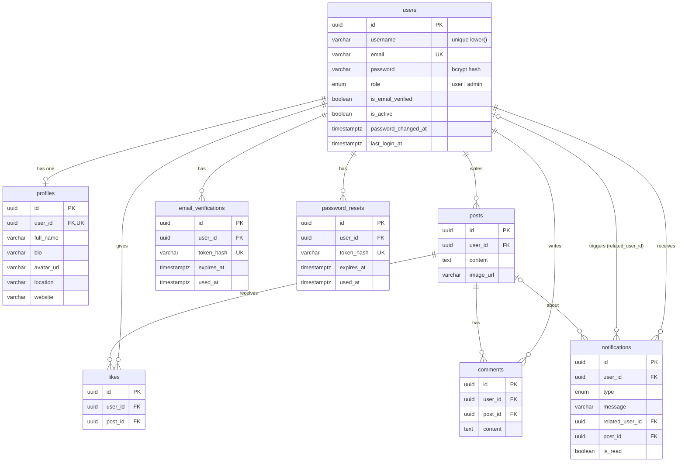

# Database Schema

PostgreSQL database `social_media_db`, managed with Sequelize models and **migrations** (`src/database/migrations`, run with Umzug, the migration engine behind `sequelize-cli`). Applied migrations are recorded in the `SequelizeMeta` table. `sequelize.sync()` is not used.

All primary keys are UUID v4. Timestamps are `TIMESTAMP WITH TIME ZONE`, in snake_case (`created_at`, `updated_at`).

## Entity-relationship diagram



## Tables

### users

Accounts and authentication state.

| Column | Type | Null | Default | Notes |
|---|---|---|---|---|
| id | UUID | no | UUIDv4 (app) | PK |
| username | VARCHAR(50) | no | | 3–50 chars, trimmed; unique case-insensitively |
| email | VARCHAR(255) | no | | Stored lowercase; unique |
| password | VARCHAR(255) | no | | bcrypt hash (cost 12); excluded from queries by default |
| role | ENUM(`user`,`admin`) | no | `user` | Never settable through the API |
| is_email_verified | BOOLEAN | no | false | |
| is_active | BOOLEAN | no | true | Deactivated users cannot log in or use tokens |
| password_changed_at | TIMESTAMPTZ | yes | | JWTs issued before this are rejected |
| last_login_at | TIMESTAMPTZ | yes | | Updated on each successful login |
| created_at / updated_at | TIMESTAMPTZ | no | | |

Indexes and constraints:

- `users_pkey` (id)
- `users_email_key` UNIQUE (email)
- `users_username_lower_unique` UNIQUE (lower(username)): "John" and "john" cannot both exist
- `users_created_at_idx` (created_at): recent registrations
- `users_last_login_at_idx` (last_login_at): recent logins

### profiles

Optional public profile details (one per user). Account data stays on `users`, so `username` is not duplicated.

| Column | Type | Null | Notes |
|---|---|---|---|
| id | UUID | no | PK |
| user_id | UUID | no | FK → users.id, **UNIQUE** (one-to-one), ON DELETE CASCADE |
| full_name | VARCHAR(100) | yes | |
| bio | VARCHAR(500) | yes | |
| avatar_url | VARCHAR(500) | yes | http/https only |
| location | VARCHAR(100) | yes | |
| website | VARCHAR(255) | yes | http/https only |
| created_at / updated_at | TIMESTAMPTZ | no | |

Created the first time a user updates their profile.

### posts

| Column | Type | Null | Default | Notes |
|---|---|---|---|---|
| id | UUID | no | gen_random_uuid() | PK |
| user_id | UUID | no | | FK → users.id ON DELETE CASCADE |
| content | TEXT | no | | 1–5000 chars |
| image_url | VARCHAR(500) | yes | | http/https only |
| created_at / updated_at | TIMESTAMPTZ | no | now() | |

Indexes:

- `posts_created_at_idx` (created_at): feed ordering
- `posts_user_id_created_at_idx` (user_id, created_at): posts by a user

### likes

Join table between users and posts.

| Column | Type | Null | Notes |
|---|---|---|---|
| id | UUID | no | PK |
| user_id | UUID | no | FK → users.id ON DELETE CASCADE |
| post_id | UUID | no | FK → posts.id ON DELETE CASCADE |
| created_at | TIMESTAMPTZ | no | |

Constraints and indexes:

- `likes_user_id_post_id_unique` UNIQUE (user_id, post_id): **one like per user per post**, enforced by the database even under concurrent requests. Also serves the "did I like this post" lookup.
- `likes_post_id_idx` (post_id): like counts per post

### comments

| Column | Type | Null | Notes |
|---|---|---|---|
| id | UUID | no | PK |
| user_id | UUID | no | FK → users.id ON DELETE CASCADE |
| post_id | UUID | no | FK → posts.id ON DELETE CASCADE |
| content | TEXT | no | 1–1000 chars |
| created_at / updated_at | TIMESTAMPTZ | no | |

Indexes:

- `comments_post_id_created_at_idx` (post_id, created_at): listing a post's comments in order and counting them
- `comments_user_id_idx` (user_id)

### notifications

Persistent inbox. Socket.IO only delivers these rows in real time; this table is the source of truth.

| Column | Type | Null | Notes |
|---|---|---|---|
| id | UUID | no | PK |
| user_id | UUID | no | Recipient. FK → users.id ON DELETE CASCADE |
| type | ENUM(`login`,`like`,`comment`,`announcement`) | no | |
| message | VARCHAR(500) | no | Human-readable; never contains passwords or tokens |
| related_user_id | UUID | yes | Actor. FK → users.id **ON DELETE SET NULL** (history is kept) |
| post_id | UUID | yes | FK → posts.id ON DELETE CASCADE |
| is_read | BOOLEAN | no | default false |
| created_at | TIMESTAMPTZ | no | |

Indexes:

- `notifications_user_id_created_at_idx` (user_id, created_at): inbox listing
- `notifications_user_id_is_read_idx` (user_id, is_read): unread counts
- `notifications_dedupe_idx` (user_id, type, related_user_id, post_id): duplicate checks

### email_verifications and password_resets

Identical structure. Single-use, expiring tokens.

| Column | Type | Null | Notes |
|---|---|---|---|
| id | UUID | no | PK |
| user_id | UUID | no | FK → users.id ON DELETE CASCADE |
| token_hash | VARCHAR(64) | no | **SHA-256 of the token**, UNIQUE. The raw token exists only in the email |
| expires_at | TIMESTAMPTZ | no | Verification: +24 h. Reset: +15 min |
| used_at | TIMESTAMPTZ | yes | Set on use, or when a newer token is issued |
| created_at | TIMESTAMPTZ | no | Also used for the 60-second resend cooldown |

Index: (user_id, created_at).

## Relationships (Sequelize associations)

Declared in `src/models/index.js`:

| Association | Alias | Foreign key | On delete |
|---|---|---|---|
| User hasOne Profile / Profile belongsTo User | `profile` / `user` | profiles.user_id | CASCADE |
| User hasMany Post / Post belongsTo User | `posts` / `author` | posts.user_id | CASCADE |
| User hasMany Like / Like belongsTo User | `likes` / `user` | likes.user_id | CASCADE |
| Post hasMany Like / Like belongsTo Post | `likes` / `post` | likes.post_id | CASCADE |
| User hasMany Comment / Comment belongsTo User | `comments` / `author` | comments.user_id | CASCADE |
| Post hasMany Comment / Comment belongsTo Post | `comments` / `post` | comments.post_id | CASCADE |
| User hasMany Notification / Notification belongsTo User | `notifications` / `recipient` | notifications.user_id | CASCADE |
| Notification belongsTo User | `actor` | notifications.related_user_id | SET NULL |
| Notification belongsTo Post | `post` | notifications.post_id | CASCADE |
| User hasMany EmailVerification / PasswordReset | `emailVerifications` / `passwordResets` | user_id | CASCADE |

### Why these deletion rules

- **CASCADE** for owned data: deleting a user removes their profile, posts, likes, comments, tokens and inbox. Deleting a post removes its likes, comments and notifications. No orphans are possible.
- **SET NULL** for `notifications.related_user_id`: if the actor is deleted, the recipient keeps the notification (the message text still says who did it).
- Admin deletion is guarded in the application: you cannot delete yourself or the last active admin.

## How the counts are computed

Posts do not store counters. Each page of posts is read in **one** query:

```sql
SELECT p.id, p.content, ...,
  (SELECT COUNT(*) FROM likes    l WHERE l.post_id = p.id)::int AS likes_count,
  (SELECT COUNT(*) FROM comments c WHERE c.post_id = p.id)::int AS comments_count,
  EXISTS (SELECT 1 FROM likes l WHERE l.post_id = p.id AND l.user_id = $viewer) AS liked_by_me
FROM posts p
JOIN users u ON u.id = p.user_id AND u.is_active
LEFT JOIN profiles pr ON pr.user_id = u.id
ORDER BY p.created_at DESC, p.id DESC
LIMIT 10 OFFSET 0;
```

Each subquery uses an index (`likes_post_id_idx`, `comments_post_id_created_at_idx`, `likes_user_id_post_id_unique`), so cost grows with the page size, not the table size. At very large scale, the next step would be denormalized counter columns updated by triggers, or cursor-based pagination.

## Migrations

| File | Change |
|---|---|
| `20261031000001-baseline-users-profiles.js` | Creates `users` and `profiles` only if missing (the tables originally came from `sync()`; existing data is untouched) |
| `20261031000002-add-user-session-columns.js` | `password_changed_at`, `last_login_at` + indexes |
| `20261031000003-create-auth-tokens.js` | `email_verifications`, `password_resets` |
| `20261031000004-create-posts.js` | `posts` + indexes |
| `20261031000005-create-likes.js` | `likes` + unique constraint |
| `20261031000006-create-comments.js` | `comments` + indexes |
| `20261031000007-create-notifications.js` | `notifications` + indexes |

```bash
npm run migrate          # apply pending
npm run migrate:status   # list
npm run migrate:undo     # revert the last one (the baseline refuses to revert)
```

Tests use a separate database (`TEST_DATABASE_URL`, e.g. `social_media_test_db`), which `npm test` creates and migrates automatically.
